# PROOF POINT: Excise-to-Shelf Analytics for an Australian Drinks Company

**Every February and August, Australian alcohol excise goes up automatically. Distributors and retailers then add their margin on top of that tax, so the shopper pays more than the tax rise itself. Meanwhile, Australians are drinking less.**

This project asks what that means for a drinks business: which packs get pushed past the prices shoppers won't pay, where trade spend is leaking, and what a brand owner or distributor should do about it.

I built it three ways: an interactive **Excel** pricing model, a 7-page **Power BI** commercial report, and a **Tableau** market story. All three are based on a fictional NSW drinks company, Southerly Drinks Co.

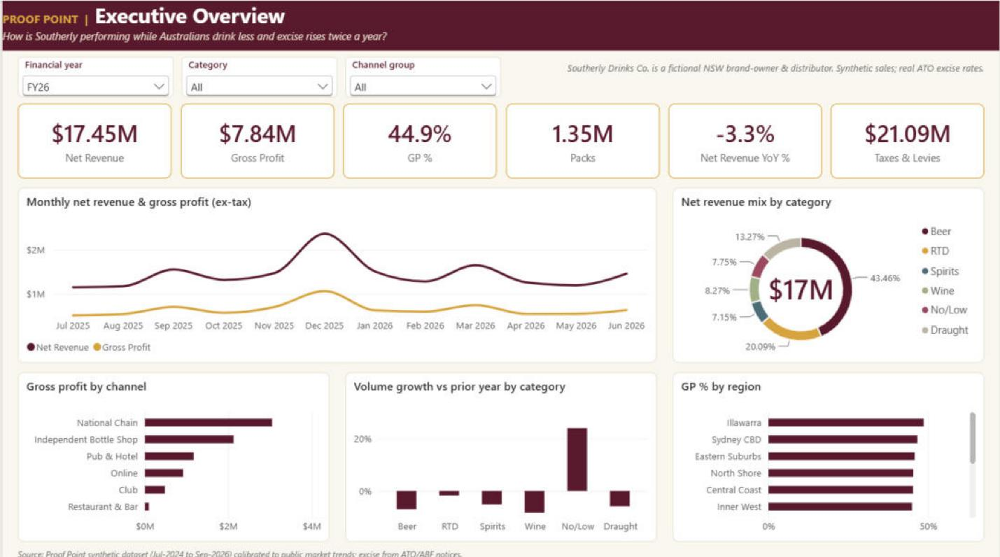

---

## What I found (FY26 vs FY25)

| | Finding | Number |
|---|---|---|
| 1 | **Tax is bigger than the business.** Excise, the container deposit levy and WET add up to more than the company's own net revenue. | $21.1M tax vs $17.5M net revenue. That is 54.7% of every net-sales dollar, and 75% on spirits. |
| 2 | **Volume is falling. No/low is the only real growth.** | Packs −3.2% (beer −7.0%, wine −8.3%). No/low +24.1%. |
| 3 | **The revenue drop is a volume problem, not a price problem.** | Net revenue −$0.60M: volume −$0.58M, price +$0.13M, mix −$0.15M. |
| 4 | **Promotions lose money.** Percentage discounts are taken off a tax-inclusive price, so the business gives away tax it never kept. | $2.17M of discounts returned −$1.21M of incremental gross profit (ROI −56%). |
| 5 | **Margins magnify tax.** | $1 of beer excise becomes about $1.48 at the shelf ($1.62 for spirits). |
| 6 | **Price points are breaking.** | 13 of 24 packs are already over their price point, or will cross it by Aug-2027. |
| 7 | **Small ABV changes matter.** Cutting the lager from 4.6% to 4.4% and holding the shelf price adds about $113K gross profit a year. VB's 2009–2012 cut shows the risk of going further. | +$113K GP a year |
| 8 | **Choose the response per SKU.** Deciding pass on, split or absorb for each pack beats passing every rise straight through. | +$44K GP vs blanket pass-through |

---

## What's in the repo

| Tool | File | What it does |
|---|---|---|
| **Excel** | [`excel/ProofPoint_Excise_to_Shelf_Simulator.xlsx`](excel/) | Live price build-up from producer price to excise, deposit, margins, WET, GST and shelf price. Also includes a Cliff Scanner across 24 packs, an ABV Lab and a pass / split / absorb Scenario Planner. About 1,800 formulas, no macros. |
| **Power BI** | [`powerbi/ProofPoint_Commercial_Report.pbix`](powerbi/) | 7 pages: Executive Overview, Gross-to-Net & Price-Volume-Mix, Portfolio & Price Points, Promotion Effectiveness, Channels & Customers, Excise Impact, About. Star schema with 53 DAX measures. |
| **Tableau** | [`tableau/ProofPoint_NSW_Market_Story.twbx`](tableau/) | One-page story: NSW outlet map, category volume trend, real excise rate history, tax share by category, revenue by region. |
| **Python** | [`python/`](python/) | Generates the synthetic dataset, builds the CSVs and the Excel model, and independently re-checks every Excel price calculation. |

---

## Power BI report

| | |
|---|---|
| 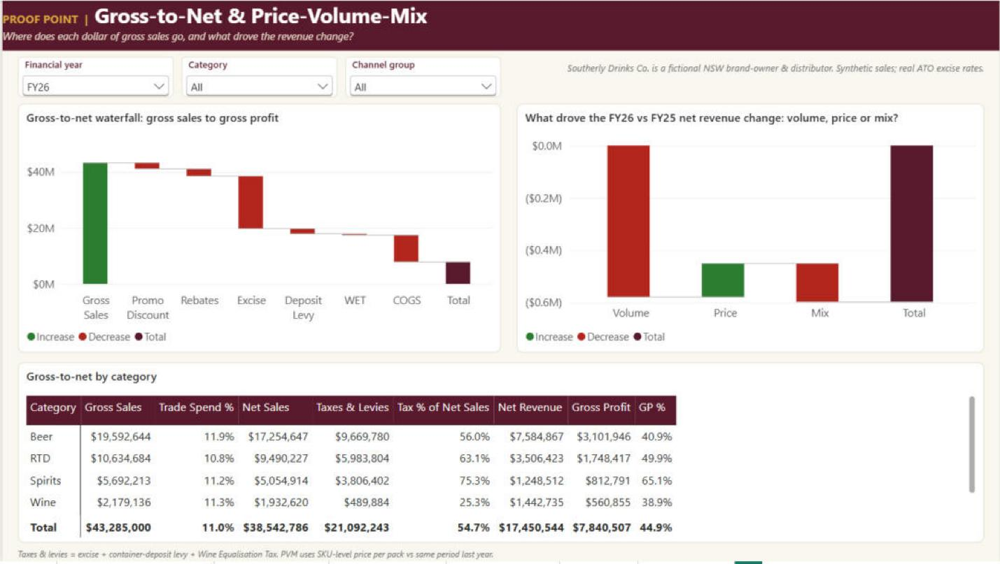 | 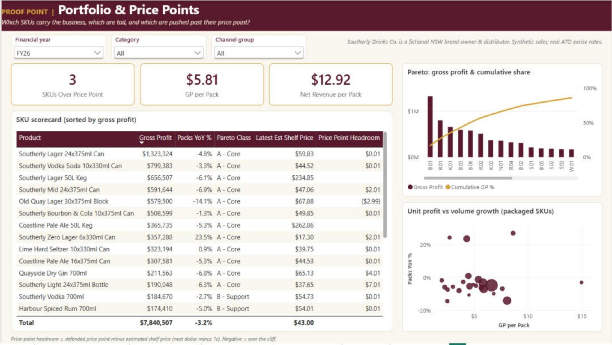 |
| **Gross-to-Net & Price-Volume-Mix.** Where each dollar of gross sales goes, and what drove the revenue change. | **Portfolio & Price Points.** Pareto of gross profit, an SKU scorecard and headroom to each price point. |
| 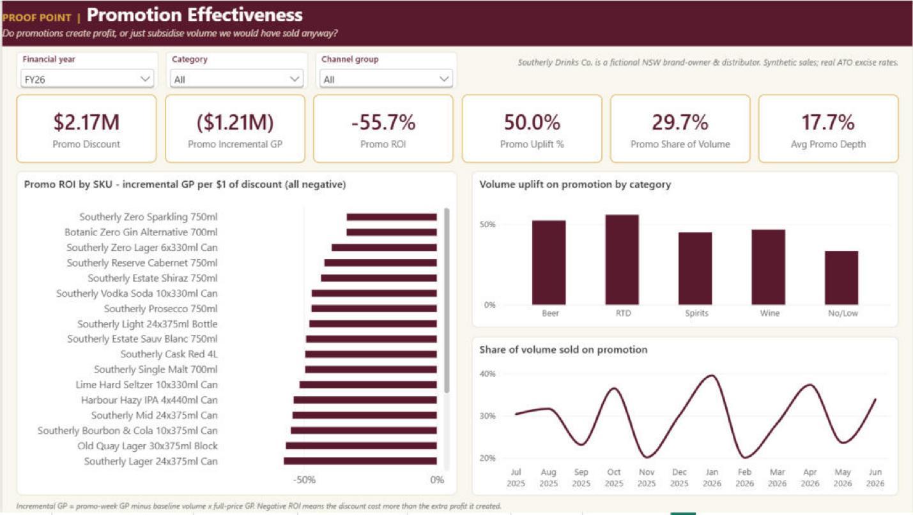 | 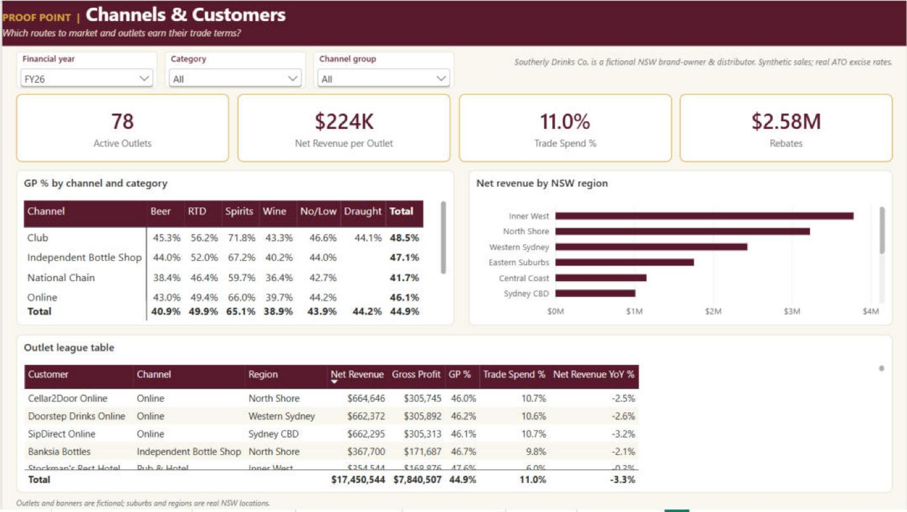 |
| **Promotion Effectiveness.** Incremental gross profit per $1 of discount, uplift and promo share. | **Channels & Customers.** GP% by channel and category, and an outlet league table. |
| 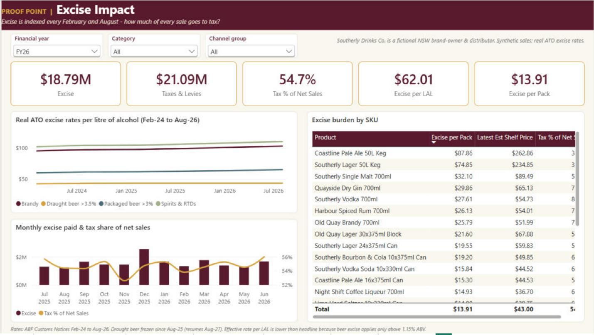 | |
| **Excise Impact.** Real ATO rates, excise per litre of alcohol and tax share of sales. | |

**Model:** a star schema with FactSales (45,898 monthly rows) plus Product, Customer, Date and Excise Rate dimensions. The DAX covers gross-to-net, YoY with `SAMEPERIODLASTYEAR`, SKU-level price-volume-mix, promo ROI against baseline volume, Pareto ranking with `RANKX` and price-point headroom. The full model is in [`powerbi/model-tmdl`](powerbi/model-tmdl) as readable TMDL.

## Excel simulator

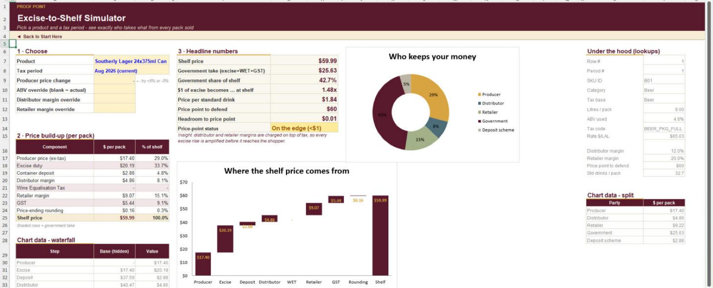

| | |
|---|---|
| 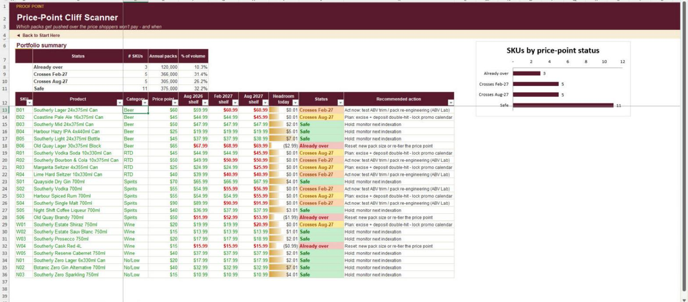 | 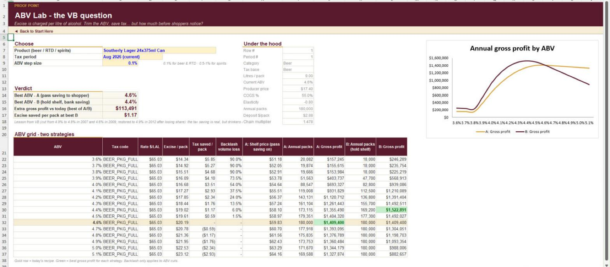 |
| **Cliff Scanner.** Shelf price for every pack today, after Feb-2027 and after Aug-2027 indexation, flagged against its price point. | **ABV Lab.** Trim the ABV, save excise, and see the gross profit with and without a shopper backlash. |

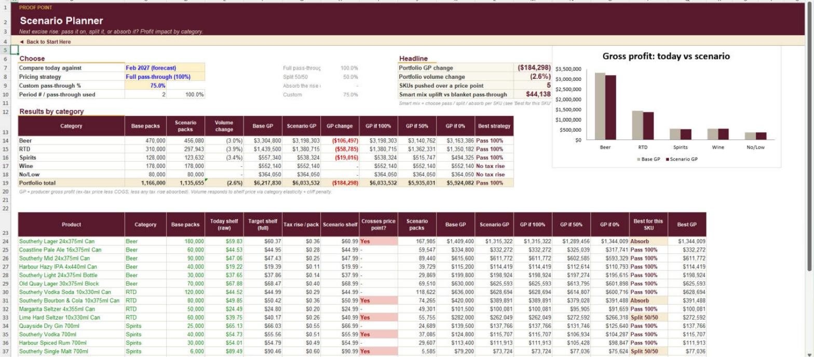

## Tableau story

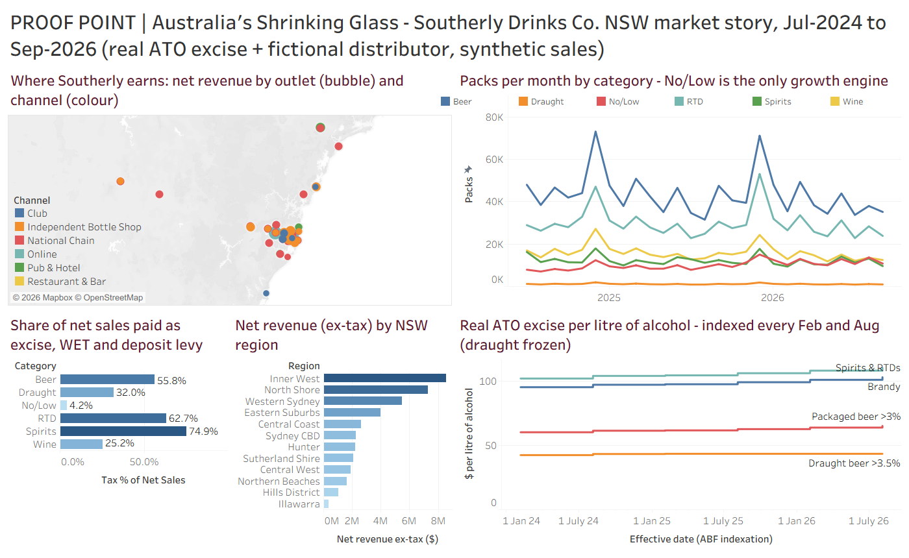

---

## How the shelf price is built

This is the logic behind the whole project (Australian rules, rates as at Aug-2026):

```
Excise (beer)          = litres x (ABV - 1.15%) x rate per litre of alcohol    (first 1.15% is excise-free)
Excise (spirits, RTD)  = litres x ABV x rate per litre of alcohol
Distributor price      = (producer price + excise + container deposit) x (1 + distributor margin)
WET (wine only)        = 29% of the wholesale value
Shelf price            = (distributor price + WET) x (1 + retailer margin) x 1.10 GST, rounded up to $x.99
```

Because both margins sit on top of excise, $1 of beer excise turns into 1.12 × 1.20 × 1.10 = **$1.48** at the shelf.

## Data: what's real and what's synthetic

- **Real:** ATO / ABF excise rates by effective date (Aug-2023 to Aug-2026, from ABF Customs Notices), the draught beer freeze from Aug-2025, the 1.15% beer allowance, WET at 29%, GST at 10%, and NSW suburbs and regions.
- **Synthetic:** Southerly Drinks Co. is **fictional**, and so are its 26 products, 78 outlets and their banners. Prices, volumes, promotions and margins are generated in Python with a fixed seed. They are calibrated to public trends (falling consumption, growing no/low, a wine oversupply).
- **Note:** the one light beer (≤3% ABV) in the range is taxed at estimated rates, back-cast from the published indexation factors. For that reason it is left out of the "real rates" table.

Any resemblance between a fictional product or outlet name and a real business is unintended.

## How to open it

- **Excel:** open the workbook and start on the *Start Here* tab. Blue cells are inputs; everything else is formula-driven.
- **Tableau:** open the `.twbx`. The data is packaged inside.
- **Power BI:** open the `.pbix`. The data is cached, so it works straight away. To refresh, go to *Transform data → Data source settings* and point the five sources at the CSVs in `data/powerbi`.

## Reproduce the data

```bash
cd python
pip install -r requirements.txt
python 01_generate_synthetic_data.py   # weekly synthetic sales (fixed seed)
python 02_build_csvs.py                 # monthly CSVs for Power BI and Tableau -> ../data
python 03_build_excel_model.py          # rebuilds the Excel model's formulas and layout
python 04_verify_excel_model.py         # re-computes every price in plain Python and compares with Excel
```

Running steps 1 and 2 reproduces the CSVs in `data/` byte for byte. Step 2 also writes `data/tableau/Southerly_Sales_Monthly.csv` (13 MB), the flat file behind the Tableau story. It isn't committed here because the same data is already packaged inside the `.twbx`. Step 4 re-checks all 72 SKU × period price build-ups against Excel; the maximum difference is 0.

## Repo structure

```
excel/      Excise-to-Shelf Simulator (.xlsx)
powerbi/    Commercial report (.pbix), theme, data model as TMDL
tableau/    NSW market story (.twbx)
data/       CSVs used by Power BI and Tableau (the large Tableau flat file is rebuilt by python/02)
python/     data generation, CSV build, Excel builder, verification
images/     screenshots used in this README
```

---

**Suhas Eedala** · Master of Business Analytics, University of Technology Sydney
